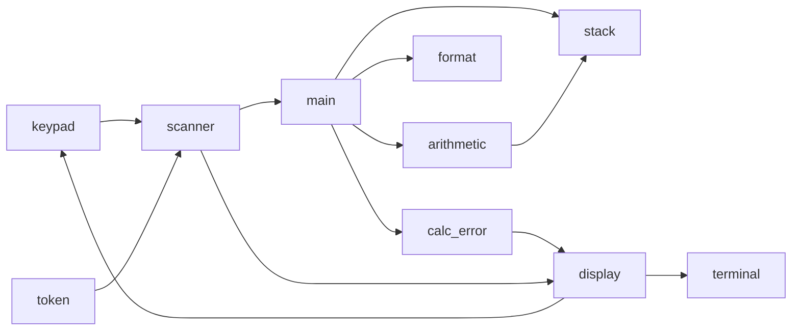

# Modulkonzept

Der Rechner ist in Eingabe, Daten, Rechnung und Ausgabe getrennt. `scanner` und `display` sind vorgegeben und kapseln Touch-Tastatur und LCD. Der eigene Code kennt dadurch weder Koordinaten noch die Entprellung der Tasten.

## token

Beschreibt, was eine Taste für den Rechner bedeutet. Der Scanner erzeugt diese Werte, `main` verbraucht sie. Enter ist nur ein Trenner innerhalb des Scanners.

## scanner

`nextToken` liest über `getKeyPadInput` und fasst Ziffern zu einer Zahl zusammen. Aufeinanderfolgende Zahlen trennt Enter. Dieses Token verlässt den Scanner nicht. Während der Eingabe schreibt der Scanner Ziffern auf das Echo-Terminal. Passt die Zahl nicht in `signed int`, kommt `OVERFLOW` zurück, bevor die Multiplikation mit 10 den Wertebereich verlässt.

Aufrufer ist nur `main`. Kein Zahlenzeiger, das Ergebnis steckt im `T_token`. Fehler der Zahleneingabe ist das Token `OVERFLOW`, kein `Result`-Code, weil der Scanner die vorgegebene Schnittstelle behält.

## display

`initDisplay` initialisiert LCD und Touch, zeichnet die Tastatur und legt daneben zwei Terminals an. Oben erscheinen Ergebnisse und Fehler, unten die laufende Zifferneingabe. `setErrMode` und `setNormalMode` setzen Farbe und löschen die Ausgabe. Weitere eigene Zeichenfunktionen sind nicht nötig, `terminal` bleibt hinter diesem Modul.

## stack

Speichert bis zu 32 `int`-Werte. `top` ist der Index des nächsten freien Platzes, nicht der oberste Wert.

| Funktion | Aufgerufen von | Eingabe | Ergebnis | Fehler |
| --- | --- | --- | --- | --- |
| `stack_init`, `stack_clear` | `main` | Stack | leer | keiner |
| `stack_push` | `main`, Arithmetik, `d` | Wert | Status | Overflow |
| `stack_pop` | Arithmetik, `r` | Zeiger auf Wert | Status und Wert | Underflow |
| `stack_peek` | `p`, `d` | Zeiger auf Wert | Status und Wert, Stack bleibt | Underflow |
| `stack_duplicate` | `main` für `d` | Stack | oberster Wert zweimal | Underflow, Overflow |
| `stack_swap` | `main` für `r` | Stack | beide obersten getauscht | Underflow, Stack bleibt erhalten |
| `stack_copy_top` | `P` | Puffer und maximale Anzahl | bis zu drei Werte, oberster zuletzt | 0 bei leerem Stack |
| `stack_size`, `stack_is_empty` | Abfragen | Stack | Anzahl oder leer | keiner |

`d` und `r` liegen im Stackmodul, weil sie keine Rechnung sind, sondern nur die Lage der Einträge ändern.

## arithmetic

`+ - * /` nehmen zwei Werte vom Stack. Der oberste ist der rechte Operand: `10 3 -` ergibt `7`, `20 4 /` ergibt `5`. Vor der Operation wird der Wertebereich geprüft. Bei Fehler liegen beide Operanden wieder in der ursprünglichen Reihenfolge auf dem Stack.

Aufrufer ist `main`. Rückgabe ist nur `Result`, das Zahlenresultat geht über `stack_push` zurück auf den Stack.

## format

`int_to_string` wandelt auch negative Werte um. `INT_MIN` wird über den Betrag als `unsigned int` gebildet, damit die Umwandlung selbst keinen Überlauf auslöst. Aufgerufen von `p` und `P`. Der Text landet im übergebenen Puffer, einen Fehlercode gibt es nicht.

## calc_error

Einziger Ort für die Fehlertexte. `main` übergibt den `Result`-Code. Das Modul setzt den Fehlermodus und schreibt die Zeile aus dem Fehlerkonzept. So bleibt die Formulierung an einer Stelle.

## main

Initialisiert das Board mit `initITSboard`, danach Display und Stack. Die Schleife holt Tokens und ruft die passende Funktion auf. `p` gibt den obersten Wert mit Zeilenumbruch aus und lässt den Stack stehen. `P` gibt höchstens die drei obersten Werte in einer Zeile aus. Ein leerer Stack ist bei `p` und `P` ein Underflow. Nach einem Fehlerstatus bleibt der Rechner stehen, bis `C` kommt.

## Begründung der Schnitte

Eingabe und LCD sind vorgegeben, weil Tastatur und Terminal sonst in jeder Operation auftauchen würden. Der Stack kennt das Display nicht, die Arithmetik kennt nur den Stack. Dadurch lassen sich Stack und Rechnung auf dem PC testen. Fehler laufen als Status nach oben, Zahlen nie als versteckter Fehlercode. Die Ausgabe einer Zahl ist von der Rechnung getrennt, weil dieselbe Umwandlung für `p` und `P` gilt.
