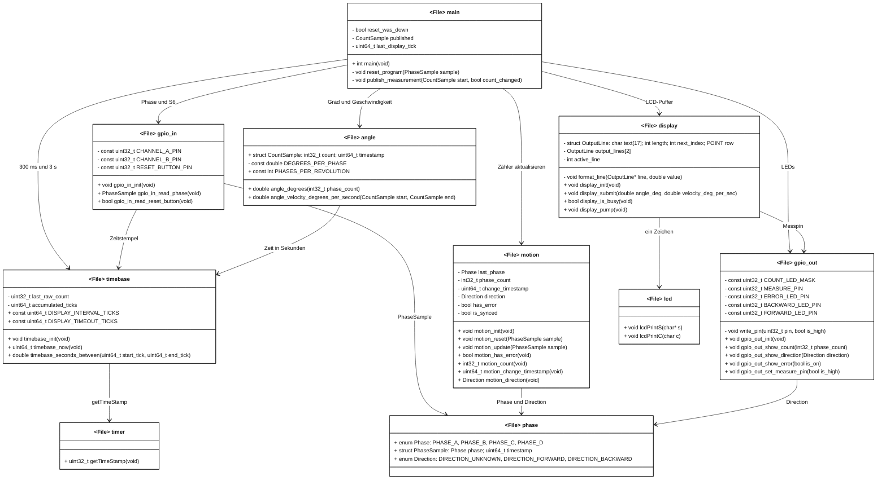

# Modulkonzept

Ein Kasten ist ein C-Modul, also eine `*.h` und eine `*.c`. Das Modul gibt es einmal im Programm. `+` ist von anderen Modulen benutzbar, `-` nur innerhalb des Moduls. Oberhalb des Strichs stehen Typen und Variablen, unterhalb die Funktionen. Der Pfeil zeigt auf das benutzte Modul. Die Beschriftung nennt, was davon gebraucht wird. Kein Modul liest die mit `-` markierten Daten eines anderen Moduls.

`phase` hält nur die gemeinsamen Typen. `timer` und `lcd` sind Module der Board-Bibliothek.

## Verhalten

`timebase_now` addiert die vorzeichenlose Differenz des Timerregisters in `accumulated_ticks`. Die Zeit bleibt damit nach dem Überlauf des 32-Bit-Zählers richtig. `gpio_in_read_phase` liest PF0 und PF1 und hängt den Zeitstempel direkt an die Phase. S6 ist low-aktiv.

`motion_update` zählt einen Nachbarwechsel vorwärts als +1 und rückwärts als -1. Dieselbe Phase ändert nichts. Ein Sprung setzt `has_error`; Zähler und Zeitstempel bleiben stehen. `motion_reset` übernimmt die aktuelle Phase neu und setzt den Zähler auf 0.

1200 Phasenwechsel sind eine Umdrehung. Winkel und Geschwindigkeit rechnen mit `double`. Ohne neuen Wechsel ist die Geschwindigkeit 0. `display_init` schreibt die Beschriftungen einmal. `display_pump` gibt pro Aufruf höchstens ein Zeichen aus. Die unteren 8 Bit des Zählers liegen auf PD0 bis PD7, Richtung, Fehler und Messpegel auf PE4 bis PE7.

`main` liest am Anfang des Durchlaufs Phase und S6 und arbeitet danach nur mit diesen Werten. Neue LCD-Zahlen gibt es erst bei leerem Puffer, frühestens 300 ms nach der letzten Ausgabe, und ohne Phasenwechsel spätestens nach 3 s.

## Schnitt

Die Register von Drehgeber, Taster, LEDs und Timer liegen in `gpio_in`, `gpio_out` und `timebase`. `motion` ist der Zustand des Drehgebers. `angle` rechnet nur. `display` ist die Ausgabe. `main` verbindet diese Teile und hält keine Kopien der versteckten Zähler.
