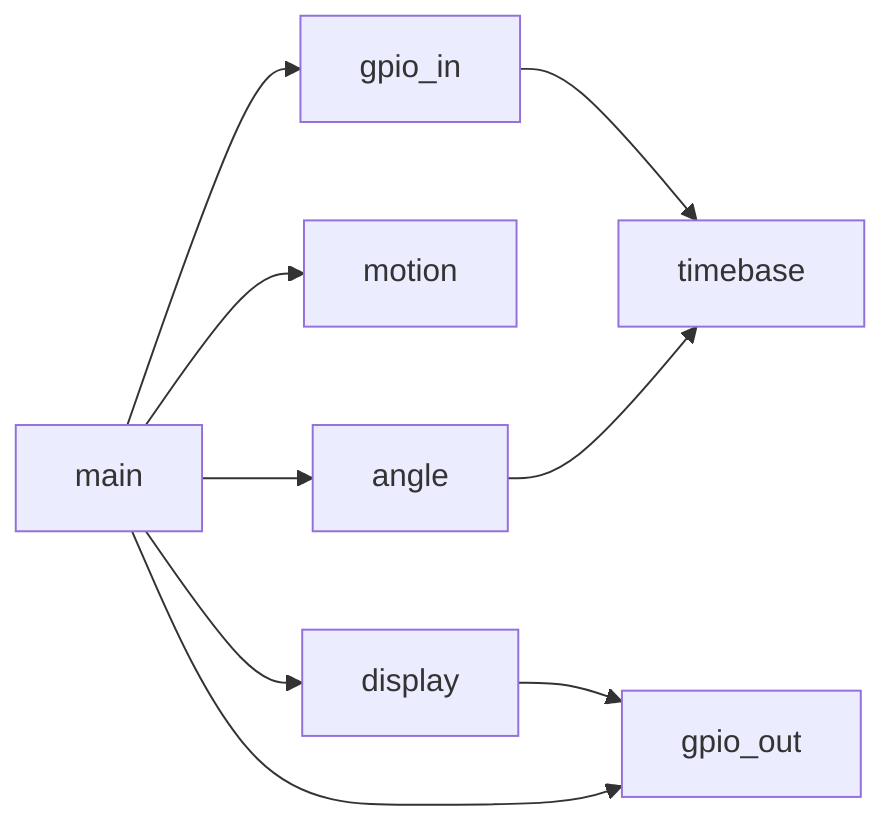

# Modulkonzept

Die Super-Loop liest am Anfang nur noch die schon abgelegte Messung. GPIO, Zeit und LCD bleiben in eigenen Modulen.

## timebase

`timebase_now` liest `TIM2->CNT`. Der Zähler läuft 90-mal je Mikrosekunde und springt nach etwa 47 s von `0xFFFFFFFF` auf 0. Jeder Aufruf addiert die vorzeichenlose Differenz zum letzten Wert in ein 64-Bit-Register. Dadurch bleibt die Zeitspanne auch nach mehreren Überläufen richtig, solange die Funktion in jedem Super-Loop-Durchlauf läuft.

Aufgerufen von `gpio_in_read_phase` und einmal beim Start. Rückgabe ist der monotone Tick. Einen Fehlercode gibt es nicht.

## gpio_in

`gpio_in_read_phase` liest PF0 und PF1 und hängt den Zeitstempel direkt an die Phase. Das ist die Messung, mit der der Rest des Durchlaufs arbeitet.

| A | B | Phase |
| --- | --- | --- |
| 0 | 0 | a |
| 1 | 0 | b |
| 1 | 1 | c |
| 0 | 1 | d |

`gpio_in_read_reset_button` liest nur S6. Aufrufer ist `main`.

## motion

Speichert die letzte Phase, den Phasenzähler, den Zeitstempel des letzten gezählten Wechsels, die letzte Richtung und das Fehlerbit.

`motion_update` bekommt eine `PhaseSample`. Der erste Aufruf übernimmt die Phase, ohne zu zählen. Danach gilt:

- eine Phase vorwärts: Zähler plus 1, Richtung vorwärts
- eine Phase rückwärts: Zähler minus 1, Richtung rückwärts
- dieselbe Phase: keine Änderung
- ein Sprung über eine Phase: Fehler, Zähler und Zeitstempel bleiben

Nach einem Fehler ignoriert das Modul weitere Messungen, bis `motion_reset` die aktuelle Phase neu übernimmt und den Zähler auf 0 setzt.

## angle

Rechnet nur. 1200 Phasenwechsel sind eine Umdrehung, also 0,3 Grad je Schritt. `angle_degrees` und `angle_velocity_degrees_per_second` rechnen mit `double`. Die Geschwindigkeit teilt die Zählerdifferenz durch die Zeit zwischen den beiden Wechsel-Zeitstempeln. Ohne neuen Wechsel ist die Geschwindigkeit 0.

## display

`display_init` schreibt die beiden Beschriftungen einmal. `display_submit` legt Winkel und Geschwindigkeit in zwei Puffer. `display_pump` schreibt daraus pro Aufruf ein Zeichen mit `lcdPrintC`. Vor dem Zeichen geht D20 auf high, danach auf low.

## gpio_out

Schreibt die unteren 8 Bit des Zählers nach PD0 bis PD7, die Richtung nach D23 und D22, den Fehler nach D21 und den Messpegel nach D20. Die Bits werden über `BSRR` gesetzt und gelöscht.

## main

Ein Durchlauf liest Phase und S6, erkennt die steigende Flanke von S6 und setzt dann nur noch mit diesen Werten fort. Ohne Fehler werden LEDs jeden Durchlauf geschrieben. Die LCD-Zahlen werden frühestens 300 ms nach der letzten Ausgabe neu berechnet, und nur, wenn der Puffer leer ist. Liegt in dieser Zeit kein Phasenwechsel, wartet die Berechnung bis zum nächsten Wechsel oder bis 3 s vergangen sind.

## Begründung

Eingabe, Zähler und Anzeige kennen einander nicht. Der Zähler kann auf dem PC mit fest vorgegebenen Phasen geprüft werden. Die langsame LCD-Ausgabe sitzt hinter einem Puffer und verlängert das Einlesen der nächsten Phase nur um ein Zeichen.
